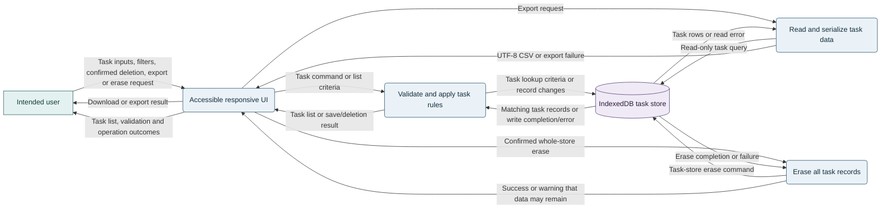

# Task Manager Architecture Options

## Status and evidence

This architecture recommendation is based on the approved MVP baseline in the [task manager requirements](./task-manager-requirements.md), approved by Leo, Product Owner, on 2026-11-13. The requirements approval does not approve this architecture or a technology stack. The repository has no application code, selected stack, deployment environment, or external integration.

The approved boundary is one intended user in a private environment, with no accounts, sign-in, or task sharing. Shared or hosted exposure remains prohibited until a security/privacy reviewer approves its data-protection boundary. The requirements also require same-environment persistence, irreversible task deletion, UTF-8 CSV export, whole-store erasure, clear failure behavior, and no MVP backup or recovery. WCAG 2.2 AA is a target, not a claim of conformance.

## Architecture overview

**Recommended MVP architecture:** A responsive, browser-based client running in the intended user's private environment, with task records stored locally in IndexedDB. The app has no account, remote task API, shared database, or external integration. The environment must be restricted to the intended user; this design does not add application-level identity or access control.

This is the simplest fit for the approved one-user boundary, but browser data can be lost if the profile or device is cleared or lost. The approved requirements exclude backup and recovery; verify that this storage limitation is acceptable for the intended private environment before implementation. Keep the local API/database option as an alternative if browser storage is not acceptable. A hosted option is out of MVP scope pending security/privacy approval and new requirements.

**Diagram notation:** teal is the external user, blue is an application process, and purple is persistent storage. The trust boundary is the intended user's private device/browser profile. Labels show exchanged data and outcomes; erase and export failures are explicit.

## Requirements and constraints

### Functional needs

- Create tasks with a non-whitespace title, optional date-only due date, and initial `Open` status (FR-01).
- View the single task list, filter by status, and combine filtering with case-insensitive title substring search (FR-02).
- Edit title and due date; reject blank replacement titles without overwriting existing values (FR-03).
- Allow direct transitions among `Open`, `In progress`, and `Done` (FR-04).
- Delete only the confirmed task; deletion has no undo or recovery in the MVP (FR-05).
- Preserve saved tasks across close/reopen in the same user environment and visibly report save failure (FR-06).
- Export a UTF-8 CSV with `title`, `status`, and `due_date` columns; export failure must leave tasks unchanged (FR-07).
- Erase all tasks only after confirmation; report erasure failure and warn that data may remain. No backups or recovery are provided in the MVP (FR-07).

### Quality attributes and constraints

- Approved deployment boundary: one intended user in a private environment, with no account creation, sign-in, or sharing (NFR-01).
- Do not expose the product to shared or hosted use until a security/privacy reviewer approves the data-protection boundary (AC-08).
- Support keyboard and screen-reader use and target WCAG 2.2 AA; evaluate before release (NFR-02, AC-09).
- Launch in English. No numeric performance or availability target is set; collect pilot baselines before setting success targets.
- A qualified privacy/compliance applicability review is required before release. No jurisdiction or regulatory regime is assumed.

## Component design

### Option A: Browser-only, local-first app (recommended MVP)

- **Accessible UI:** Responsive task capture, list, edit, status, delete, export, and erase flows. Provide keyboard-operable controls, visible focus, screen-reader names/status, and distinct empty, validation, success, and failure states.
- **Task rules:** Validate non-whitespace titles, supported statuses, and date-only due dates. Apply title substring search case-insensitively and combine it with the selected status filter.
- **Local persistence:** Store task records in IndexedDB under a stable app origin. Represent due dates as calendar dates, not timestamps. Use transactions for writes and whole-store erasure; report success only after transaction completion.
- **Task deletion:** Require confirmation and permanently delete only the selected task. Do not offer undo or recovery.
- **CSV export:** Read without modifying stored tasks; emit UTF-8 with the required columns and one row per task. If read or file generation fails, report failure and leave task records unchanged.
- **Whole-store erasure:** Require confirmation. If the operation fails, do not report success and warn that task data may remain.
- **Network boundary:** No task API, remote database, synchronization, or task-content telemetry.

The deployment packaging and stable local origin must be selected before implementation. This option relies on the intended user's private device/browser profile; it does not provide app-level identity or access control.

### Option B: Local web app with API and SQLite (alternative)

- **Task UI:** Responsive browser client.
- **Local API:** Candidate ASP.NET Core service owns validation and task operations; bind to loopback only and restrict requests to the intended local origin.
- **Persistence:** SQLite database on the user's device; use transactions for changes and erasure. Export reads remain non-mutating.
- **Boundary:** No remote hosting, accounts, sharing, or cross-device synchronization.

This remains compatible with a single-user private environment but adds installation, service lifecycle, upgrade, and local API security responsibilities. Select it only if browser-managed storage does not meet the approved same-environment persistence need. Validate origin and cross-site request protections before implementation.

### Option C: Shared or hosted app (not permitted for the MVP)

- **Task UI:** Responsive browser client.
- **API and identity:** Would require a reviewed identity/access-control boundary, even if it does not use public account creation.
- **Persistence and operations:** A remote database and operational controls would need to be selected based on approved future requirements.
- **Network boundary:** Task data would cross the private device boundary.

This option is prohibited until the security/privacy reviewer approves the data-protection boundary and the product owner approves revised requirements. Do not introduce it as a deployment-only change to the MVP.

## Architectural patterns and trade-offs

| Option | Pattern | Fit | Main trade-off |
|---|---|---|---|
| A (recommended) | Local-first responsive web app | Direct fit for approved single-user/private use and no account or sharing features. | Browser profile/device loss or clearing can make tasks unavailable; no backup/recovery exists. |
| B (alternative) | Local client/API/database | Retains a private single-user deployment while moving persistence and validation into a local service. | More runtime and security complexity; still no recovery or cross-device use. |
| C (excluded) | Hosted client/API/database | Could support a future, newly approved hosted requirement. | Violates the MVP boundary until data-protection review and scope approval. |

Do not add accounts, sharing, backups, recovery, synchronization, or remote services to the approved MVP. Any such change requires an approved requirement and, for shared/hosted exposure, security/privacy approval.

## Performance and scalability

No workload, response-time, or availability target has been approved. For Option A, load the user's task list from local storage and apply search/filter locally; pilot measurements should establish baselines for task creation, retrieval, time to find tasks, and status changes before Leo sets numeric success targets. Test persistence and failure handling in the supported browser/device combinations. Scaling beyond one user or one private environment is outside the approved MVP.

## Security and compliance

- **Option A:** Enforce the private single-user environment operationally; IndexedDB does not itself enforce the intended-user boundary. Protect the device/browser profile using the environment's access controls. Do not send task contents to telemetry or remote services. Explain that profile/device loss can make tasks unavailable; CSV export is user-controlled export, not recovery.
- **Option B:** In addition to device controls, restrict the service to loopback, validate request origins, and protect state-changing requests from cross-site access. Apply the device's access controls to the database file.
- **Option C:** Prohibited for the MVP. Any future proposal must define identity/access controls, data protection, retention, deletion behavior, operational controls, and security/privacy approval before exposure.
- **Release gate:** Complete the qualified privacy/compliance applicability review before release. Separately, obtain security/privacy approval before any future shared or hosted exposure. No jurisdiction or compliance status is assumed.
- **Erasure:** No backups exist in the MVP. Confirmed erasure and task deletion are irreversible; failures must be surfaced as specified in FR-05 and FR-07.

## Deployment and operations

- **Option A:** Run the responsive web app only within the intended user's private environment. The exact local packaging and origin mechanism is TBD; it must not expose the app or task data to a shared/hosted boundary. Pin the origin because browser storage is origin-scoped. Validate browser/device support and storage failure messaging.
- **Option B:** Package or install the local service/database for the intended user's device. Document start/stop, upgrade, and data-location behavior; add health diagnostics without logging task contents.
- **Option C:** Not deployed for the MVP. Define environments, operational ownership, monitoring, incident handling, and data policies only after the required approvals and a revised scope.

For the pilot, measure task creation/retrieval, time to find tasks, and status changes. Establish baselines before setting numeric targets. No formal availability or response-time SLA is required for the MVP.

## Technology recommendations

No stack is approved. For Option A, a React/TypeScript client and the browser IndexedDB API are candidate choices: assess accessibility support, maintainability, supported browser behavior, and reliable transaction/error handling. The architecture does not require an application API or PostgreSQL for the MVP.

For Option B, ASP.NET Core and SQLite are candidates if a local service is selected. PostgreSQL is not part of the MVP recommendation; consider a remote database only in a future, approved hosted design. These remain candidates, not selected technologies.

## Implementation roadmap

1. **Confirm deployment details:** Select supported browsers/devices and verify that the intended environment is private to the single user. Decide how the local app is packaged and served without creating shared/hosted exposure.
2. **Approve architecture and stack:** Confirm Option A and its browser storage/data-loss limitation, or select Option B if local browser persistence does not satisfy FR-06.
3. **Implement the persistence slice:** Create a task, close/reopen the app in the same environment, and verify title, status, and date-only due date persistence.
4. **Complete approved flows:** Add combined search/filter, edits, direct status changes, irreversible confirmed deletion, UTF-8 CSV export, and confirmed whole-store erasure.
5. **Validate acceptance criteria:** Test validation, transaction failures, export preserving data, erasure failure warnings, keyboard/screen-reader flows, and the approved AC-01 through AC-12.
6. **Clear release gate and pilot:** Complete qualified privacy/compliance applicability review and accessibility evaluation before release; establish pilot baselines before Leo sets numeric success targets.
7. **Reassess future scope:** Do not add hosting, sharing, accounts, backups, recovery, or synchronization without approved requirements and the required security/privacy review.

Owners for unresolved reviews, dates, costs, and numeric performance gates remain TBD.

## Assumptions and open decisions

- The approved MVP requirements, including no backups or recovery, remain the scope baseline.
- Browser-managed storage is a proposed implementation choice, not a requirement or approved technology. Confirm its persistence boundary against FR-06 before implementation.
- Which browsers and devices must the responsive web app support, and how will the local app be packaged and served without exposing it to a shared/hosted environment?
- Which private-environment controls ensure only the intended user can access the task list?
- Who will perform the qualified privacy/compliance applicability review before release?
- What data-protection conditions must be approved before any future shared/hosted exposure?
- Pilot baselines must precede numeric success targets; formal availability/response-time targets are deferred until after deployment and pilot.

## Architecture decision summary

- **Decision proposed:** Option A, a responsive client with local IndexedDB persistence and no remote task service.
- **Status:** Architecture recommendation for approval; not selected in the requirements document.
- **Rationale:** Best fit to the approved one-user private MVP and no-account/no-sharing constraints with the fewest runtime components.
- **Consequences:** Data is tied to the private browser profile and device; no backup, recovery, or cross-device sync is provided. Confirm browser persistence and private-environment controls before implementation.
- **Alternative:** Option B, local API plus SQLite, if Option A cannot satisfy same-environment persistence. Option C remains excluded until scope and boundary approval.

## Validation note

The Mermaid source is included, but rendering and visual contrast in the target renderer were not verified.
