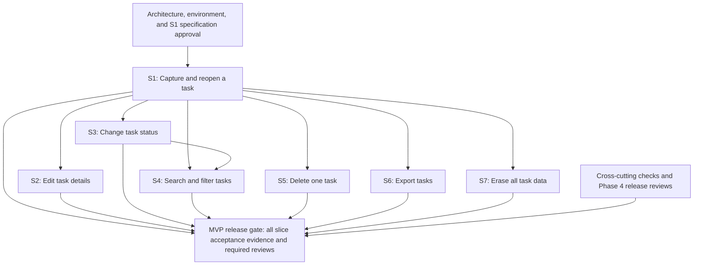

# Task Manager Vertical Slice Implementation Plan

## Status and scope

**Status:** Draft for review; not authorization to implement. The source of product scope and acceptance is the [approved task manager requirements](./task-manager-requirements.md). The [architecture options](./task-manager-architecture-options.md) provide a provisional recommendation, not an approved design or stack.

The MVP is a responsive English-language task manager for one person in a private environment. It includes task capture, listing, editing, status changes, search and filtering, deletion, persistence, CSV export, and whole-store erasure. Accounts, sign-in, sharing, backups, recovery, cross-device synchronization, and shared or hosted exposure are outside the approved MVP. The requirements remain authoritative if this plan is less detailed.

**Planning assumption selected by the user:** organize the plan around the proposed browser-only, local-first option. IndexedDB, a framework, packaging, and browser support remain unapproved. The technical lead must approve the design and confirm that browser storage and its data-loss limitations satisfy the intended environment before implementation starts. No application code or established implementation test commands were identified in the repository.

## Decisions and prerequisites

| Decision or prerequisite | Owner / timing | Effect on plan |
|---|---|---|
| Approve the architecture and stack, or select an alternative; confirm storage-loss implications. | Technical lead, before implementation. | A different architecture may change slice contracts, estimates, and dependencies; revise the plan before starting. |
| Select supported browsers and devices, local packaging and stable origin; establish how access is restricted to the intended user. | Technical lead and environment owner, before Slice 1. | Needed to test reopen persistence, responsive behavior, and the private-user boundary. Browser storage alone does not enforce that boundary. |
| Identify a qualified privacy/compliance reviewer. | Product Owner, early; applicability review completed before release. | Review must document applicable obligations and release-blocking findings. |
| Identify implementers, reviewers, capacity, and an accessibility evaluator. | Delivery owner, before scheduling. | Dates and estimates cannot be committed until these are known. |
| Approve each bounded slice specification and implementation plan. | Product Owner/reviewer and implementing team, before that slice is implemented. | Specifications must reference the requirements, define behavior and verification, and follow [specification guidance](../.github/instructions/implementation-specifications.instructions.md). |

## Delivery approach and dependencies

Each slice delivers an observable user outcome across the necessary interface, rules, persistence, and tests. The order below is a proposed sequence, not a calendar commitment. Foundational setup is included in Slice 1 rather than delivered as a layer-only milestone.

S4 follows S3 so its combined status/search acceptance can use supported status changes. S2-S3 and S5-S7 all rely on S1's data and interaction foundations. The diagram expresses logical dependencies, not permission for simultaneous implementation: shared task data, UI, and persistence contracts create integration conflicts. No implementation parallelism is yet verified. Privacy review preparation may proceed alongside specification work if the qualified reviewer and intended environment are available; its completion remains a release gate.

Priorities are proposed delivery order, not a change to scope: all seven slices are required for the MVP. Relative effort and risk are preliminary planning judgments, not estimates.

## Phase 1 - Establish the first usable task

**Objective:** Prove that a user can capture a task and reliably find it after reopening in the intended environment.

### S1 - Capture and reopen a task

- **Value:** As the intended user, I can save a task and return to it later.
- **Sources:** FR-01, FR-02's basic list, FR-06; AC-01, AC-02, AC-03 and AC-07; BR-01, BR-02 and BR-07.
- **Scope and acceptance:** Create a task with a non-whitespace title, optional calendar-date-only due date, and `Open` status; reject blank or whitespace-only titles with a clear message. Show each task's title, status and optional due date, and an empty state when no tasks exist. Close and reopen in the same environment and verify the saved fields remain. A failed save is clearly reported and never presented as successful.
- **Dependencies:** Approved architecture, environment and S1 specification. Include only the minimum app, storage and test setup needed for this end-to-end outcome.
- **Verification:** Automated behavior checks for valid and invalid titles, with and without a due date; integration or end-to-end reopen check using the chosen supported environment; exercise a save failure and inspect the user-visible result. Include the cross-cutting checks below.
- **Risk / effort:** High foundational uncertainty and potentially higher effort than later slices; mitigate with early validation of storage persistence, failure handling and environment access.

**Phase exit:** S1 acceptance evidence is reviewed; the selected environment demonstrably retains the saved fields after reopening, and the remaining slices have a usable foundation.

## Phase 2 - Manage and find tasks

**Objective:** Make captured tasks maintainable and discoverable.

### S2 - Edit task details

- **Value:** As the user, I can correct a title or due date.
- **Sources:** FR-03; AC-04; BR-05.
- **Acceptance:** Save a valid replacement title and calendar date or clear the optional date; reopen the list and observe the changes. Reject a blank replacement without overwriting the existing title.
- **Dependency:** S1.
- **Verification:** Exercise edits, date clearing, invalid input and persistence after reopening; verify save-failure reporting remains intact.
- **Risk / effort:** Moderate shared-state and validation risk; reuse verified task rules and regression checks.

### S3 - Change task status

- **Value:** As the user, I can record progress and reopen completed work.
- **Sources:** FR-04; AC-05; BR-04.
- **Acceptance:** Select `Open`, `In progress`, or `Done`; display the selected status. Permit every direct transition, including from `Done` to either other status, and reject unsupported statuses.
- **Dependency:** S1.
- **Verification:** Check each direct transition and an unsupported value; verify the saved status survives reopening and save failures remain visible.
- **Risk / effort:** Moderate risk of invalid transitions or state loss; use a complete transition test matrix.

### S4 - Search and filter the task list

- **Value:** As the user, I can find tasks by title and status together.
- **Sources:** FR-02's search and filter behavior; AC-10 and AC-03's no-match state; BR-03.
- **Acceptance:** Match title substrings without regard to case and combine search with the selected status filter. Display only matches, show an empty result for no matches, and restore the full list when both criteria are cleared.
- **Dependencies:** S1 and S3.
- **Verification:** Use multiple titles and statuses, mixed case, partial matches, combined criteria, no matches and clearing both criteria.
- **Risk / effort:** Moderate interaction risk; use representative data and regression-check the unfiltered list.

**Phase exit:** S2-S4 are demonstrated and verified, including reopening changed data, all supported status transitions and combined search/filter behavior.

## Phase 3 - Control task data

**Objective:** Give the user the approved ways to remove, export and erase data.

### S5 - Delete one task

- **Value:** As the user, I can remove a task I no longer need.
- **Sources:** FR-05; AC-06; BR-06.
- **Acceptance:** Require confirmation before deletion; after confirmation remove only the selected task. The deleted task is not recoverable in the MVP, and no undo or recovery is offered.
- **Dependency:** S1.
- **Verification:** Check cancellation and confirmation with multiple tasks; reopen and verify the selected task remains absent and other tasks remain. Use disposable test data.
- **Risk / effort:** Irreversible action risk; make confirmation clear and test against isolated data.

### S6 - Export tasks

- **Value:** As the user, I can obtain my task data in the approved format.
- **Sources:** FR-07 export; AC-11; BR-09.
- **Acceptance:** Download UTF-8 CSV with `title`, `status`, and `due_date` columns and one row per saved task. On failure, clearly report the failure and leave saved tasks unchanged.
- **Dependency:** S1.
- **Verification:** Parse the downloaded file with representative non-ASCII text, empty dates and CSV-special characters; compare rows to stored tasks. Exercise export failure and compare data before and after.
- **Risk / effort:** Encoding and serialization risk; validate the actual downloaded file rather than only an in-memory representation.

### S7 - Erase all task data

- **Value:** As the user, I can permanently erase all task data stored by the product.
- **Sources:** FR-07 erasure; AC-12; BR-09.
- **Acceptance:** Require confirmation; after confirmed erasure, no task remains available after reopening. Do not provide backups or recovery. On failure, clearly report it, do not report success, and warn that task data may remain.
- **Dependency:** S1.
- **Verification:** Check cancellation, successful erasure and reopening with disposable data; exercise an erasure failure and inspect the failure message and warning.
- **Risk / effort:** High consequence if erasure fails or is incorrectly reported; verify the real chosen storage boundary and failure behavior before release.

**Phase exit:** S5-S7 pass their demonstrations and failure checks; no undeclared recovery or backup behavior has been introduced.

## Phase 4 - Release readiness and pilot

**Objective:** Verify the complete approved MVP and clear its stated release gates.

1. Run the full acceptance trace below, including regression checks across slices. Document commands, supported environment, results and any unresolved failures; commands are to be determined from the implemented project, not assumed here.
2. Verify the single-user private environment and absence of account, sign-in and sharing controls. Do not expose the product to shared or hosted use. Any future such exposure needs Product Owner scope approval and security/privacy approval of the data-protection boundary.
3. Evaluate the product against WCAG 2.2 AA before release; record failures for resolution or explicit acceptance, as specified in AC-09. Verify core flows using keyboard and screen reader, with visible focus, in the chosen environment.
4. A qualified reviewer documents privacy/compliance applicability and any release-blocking findings. Address release-blocking findings before release; no jurisdiction or compliance outcome is assumed.
5. After release, the proposed pilot can measure task creation and retrieval, task-finding time, and status changes. Identify the accountable person before the pilot; establish baselines before Leo sets numeric targets and evaluates pilot outcomes. The pilot itself is not a launch gate.

**Exit:** All approved MVP acceptance criteria have passing evidence; applicable accessibility findings have been recorded for resolution or explicit acceptance; the qualified privacy/compliance review is complete and its release-blocking findings are addressed; and the private deployment boundary is verified. Record the release decision and any accepted accessibility findings; this plan does not assert an approval.

## Cross-cutting validation and traceability

For every slice, use behavior-focused tests and relevant integration or end-to-end checks, with disposable data and explicit failure-path evidence. Follow the repository's test-driven workflow where applicable. Keep the interface responsive and keyboard/screen-reader usable as functionality is added, then perform the complete pre-release evaluation in Phase 4. Check no account, sign-in or sharing is introduced, and preserve the private single-user environment throughout. Demonstrate and review each completed slice before starting a dependent one.

| Approved source | Primary delivery and verification point |
|---|---|
| FR-01; AC-01, AC-02; BR-01, BR-02 | S1 capture and validation |
| FR-02; AC-03, AC-10; BR-03 | S1 basic list and empty list; S4 search, filter and no-match result |
| FR-03; AC-04; BR-05 | S2 edit and reopen |
| FR-04; AC-05; BR-04 | S3 status transitions |
| FR-05; AC-06; BR-06 | S5 confirmed deletion |
| FR-06; AC-07; BR-07 | S1 persistence and save failure; regressions in later write slices |
| FR-07; AC-11, AC-12; BR-09 | S6 export; S7 erasure |
| NFR-01; AC-08; BR-08 | Environment prerequisite, every slice and Phase 4 boundary check |
| NFR-02; AC-09; BR-10 | Every slice and Phase 4 accessibility evaluation |
| English launch; MVP exclusions | Every slice and Phase 4 scope check |
| Privacy/compliance review; pilot measures and targets | Phase 4; release review before release and pilot targets after baseline |

## Risks, scheduling and next decisions

- **Data loss:** Local browser data can disappear with a cleared profile or lost device; the MVP has no backup or recovery. Technical lead and Product Owner should explicitly assess this limitation before architecture approval.
- **Private access:** A browser database is not an access-control boundary. Confirm the device/profile controls and packaging before implementation; do not infer them from the architecture recommendation.
- **Unvalidated user need:** The target user and product outcomes have not been supported by user research. Use pilot observations to inform later decisions without inventing target values.
- **Capacity and timing:** No team capacity, effort estimates, dates, or budget are supplied. Estimate each approved specification with the delivery team; the sequence above is not a duration commitment.
- **Release review:** An unidentified qualified reviewer or unaddressed release-blocking finding can delay release; identify the reviewer early.

**Next step:** Review this draft, nominate the technical and review owners, settle the architecture and environment decisions, and prepare S1's bounded specification for approval. Approval of this plan or a specification does not itself authorize implementation; the implementation workflow presents its own plan and waits for approval.
